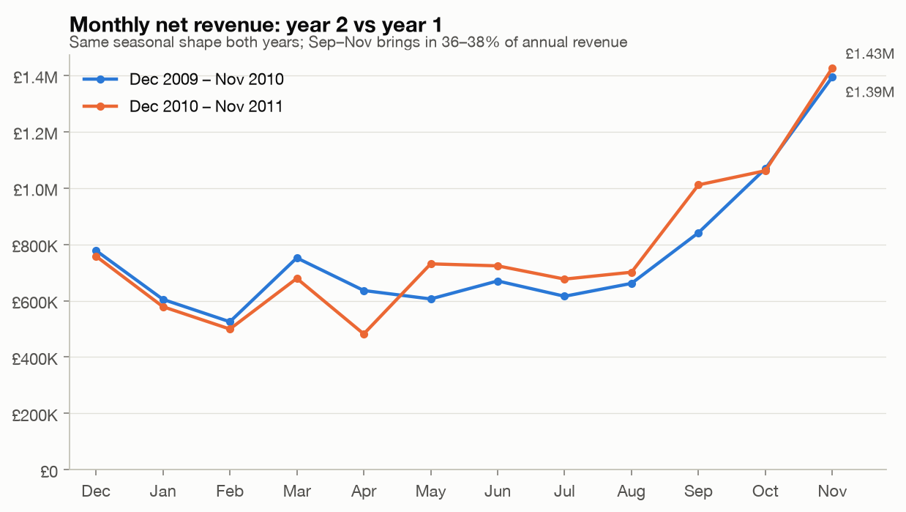
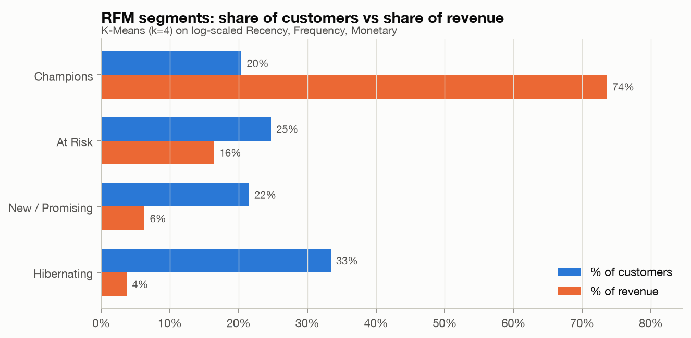
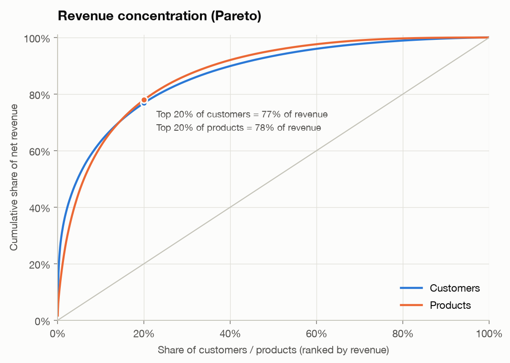
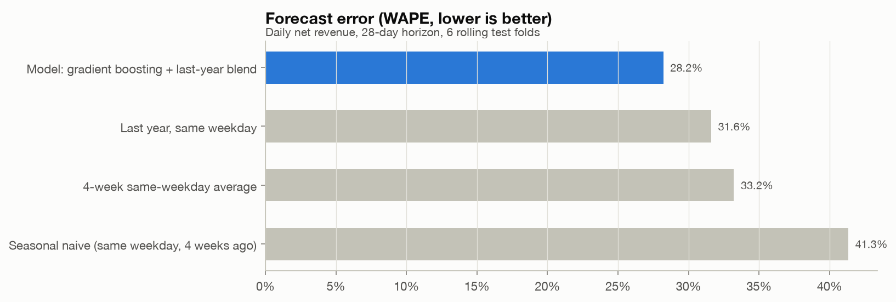
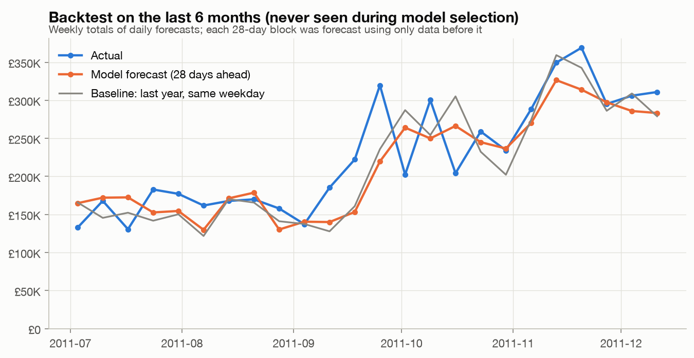
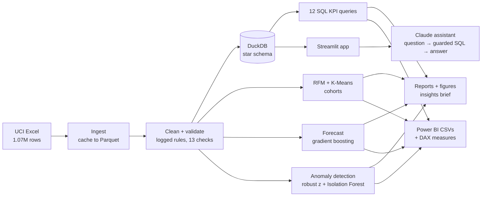

# AI-Powered Retail Business Intelligence & Decision Support System

An end-to-end analytics project on **1M+ real e-commerce transactions** (UCI Online Retail II, a UK online gift
wholesaler, Dec 2009 – Dec 2011). It goes from a messy Excel export to:

- **Validated, analysis-ready data** with a documented, reproducible cleaning log
- **A SQL KPI layer** (DuckDB star schema, 12 queries, 14 headline KPIs)
- **Customer analytics**: RFM segmentation (K-Means), cohort retention, market-basket analysis
- **A 28-day sales forecast** evaluated honestly against simple baselines
- **Anomaly detection** for unusual days and risky orders
- **An LLM decision-support assistant** (Claude) that turns business questions into safe SQL and plain-English answers
- **An interactive Streamlit app** and a **Power BI-ready star schema** with 30+ DAX measures

> One command reproduces everything: `python run_pipeline.py` (about 35 seconds after the first Excel read).

---

## Key results

| Area | Result |
|---|---|
| Data | 1,067,371 raw rows → **1,021,270 clean lines**, 39,516 orders, 5,852 customers, 4,739 products, 43 countries; 13 automated validation checks |
| Business | **£18.93M** net revenue; latest year **+1.9%** revenue on **−4.0%** orders: growth came from **+6.8% bigger baskets** |
| Concentration | Top 20% of customers = **77%** of revenue; top 20% of products = **78%** |
| Segmentation | 4 RFM segments: **Champions** are 20% of customers but **74% of revenue**; **1,442 "At Risk" customers** hold **£2.68M** of historical revenue |
| Forecasting | Daily WAPE **28.2% vs 31.6%** for the best baseline (**10.7% lower error**) on a 6-month holdout never used for model selection; **15% lower** than a 4-week same-weekday average |
| Anomalies | 181 orders flagged for review were later cancelled **2.0x** as often as other orders (11.6% vs 5.8%); 42 unusual days detected, including UK bank holidays such as the 2011 Royal Wedding |



<table>
<tr>
<td></td>
<td></td>
</tr>
<tr>
<td></td>
<td></td>
</tr>
</table>

More charts are in [`reports/figures`](reports/figures). Read the written findings in
[`reports/insights.md`](reports/insights.md), [`reports/model_results.md`](reports/model_results.md) and
[`reports/data_quality.md`](reports/data_quality.md).

---

## Architecture



## How it works

**1. Data cleaning & validation** ([`clean.py`](src/retail_bi/clean.py), [`validate.py`](src/retail_bi/validate.py))
- Found and removed **22,523 rows that appear in both yearly sheets** (1–9 Dec 2010) and **11,814 duplicate lines**.
  Some duplicates were only caught after standardising product descriptions; the validation layer flagged them.
- Removed postage, fees, manual adjustments, vouchers and test items, which are not product sales.
- **Kept cancellations as negative "return" lines**, so net revenue is correct. Dropping them would count an
  80,995-unit order that was cancelled 12 minutes later as £168K of sales.
- Kept guest checkouts (22% of lines, no customer ID) for revenue KPIs and excluded them only from customer analytics.
- Every rule is logged with the rows it removed ([data quality report](reports/data_quality.md)).

**2. SQL KPI layer** ([`sql/kpis`](sql/kpis))
- A DuckDB star schema: `fact_sales`, `dim_product`, `dim_customer`, `dim_date` and an order-level view.
- 12 queries use CTEs, window functions (`LAG`, `NTILE`, running totals), `FILTER` clauses and a self-join
  for market-basket lift. They cover headline KPIs, YoY and MoM growth, country and category performance,
  Pareto analysis, new vs returning revenue, return hotspots and repeat-purchase intervals.
- Tests check that the SQL results reconcile with pandas.

**3. Customer analytics** ([`rfm.py`](src/retail_bi/rfm.py), [`cohorts.py`](src/retail_bi/cohorts.py))
- Classic 1–5 RFM scores, plus K-Means on log-scaled, standardised R/F/M. k = 4 has the best silhouette
  score of k = 3..8, and four segments are practical for a marketing team to act on.
- Each segment gets a named profile and a recommended action.
- Monthly acquisition cohorts with a retention heatmap and second-order conversion rates.

**4. Forecasting** ([`forecast.py`](src/retail_bi/forecast.py))
- Predicts daily net revenue **28 days ahead**. Every feature is known at least 28 days in advance
  (lags ≥ 28 days, last year's values, calendar), so there's no look-ahead leakage. A unit test enforces this.
- **Rolling-origin backtest.** Model settings were chosen on a validation window (Jan–Jun 2011). Results are
  reported on the last 6 months, which were never used for selection.
- Compared with three baselines a planner would actually use. Quantile models provide an 80% prediction interval.

| Method | Daily WAPE | Weekly WAPE |
|---|---|---|
| **Gradient boosting + last-year blend** | **28.2%** | **14.4%** |
| Last year, same weekday | 31.6% | 15.5% |
| 4-week same-weekday average | 33.2% | 20.3% |
| Seasonal naive (4 weeks ago) | 41.3% | 22.2% |

**5. Anomaly detection** ([`anomalies.py`](src/retail_bi/anomalies.py))
- **Days:** a robust z-score (median/MAD) against the same weekday in the surrounding ±4 weeks. Most detected drops are UK
  bank holidays (Easter, Christmas, the Royal Wedding), which confirms the detector finds real events.
- **Orders:** an Isolation Forest on contextual features, such as how an order compares with that customer's usual
  order and with the usual line quantity for each product. I validated it against a label it never saw: flagged
  orders were later cancelled **2x** as often as other orders.

**6. LLM decision-support assistant** ([`assistant.py`](src/retail_bi/assistant.py))
- A question in plain English goes to Claude, which writes **one DuckDB SELECT query** using structured JSON output.
  That query passes a **read-only guard** (single statement, no writes, no file access) and runs on a
  **read-only, no-external-access** connection. Claude then explains the result and recommends an action,
  **using only the returned rows**.
- If a query fails, the assistant feeds the error back once so the model can correct itself. The generated SQL
  is always shown so a person can verify it.
- Without an API key it runs in **offline mode**, with curated questions and the rule-based insights brief.

---

## Run it

```bash
git clone https://github.com/jahed19960816/retail-bi-decision-support.git && cd retail-bi-decision-support
python -m venv .venv && source .venv/bin/activate
pip install -r requirements.txt

python run_pipeline.py             # downloads the data (~45 MB) and builds everything
pytest                             # 42 tests
streamlit run app/streamlit_app.py # interactive app at http://localhost:8501
```

Optional: to enable free-form AI questions, set an Anthropic API key before starting the app.
The default model is `claude-opus-5-5`; override it with `RETAIL_BI_MODEL`.

```bash
export ANTHROPIC_API_KEY=...
```

Power BI: see [`powerbi/POWER_BI_GUIDE.md`](powerbi/POWER_BI_GUIDE.md). The pipeline writes the star-schema CSVs to
`powerbi/data/`, and [`powerbi/measures.dax`](powerbi/measures.dax) has the DAX measures.

## Project structure

```
├── run_pipeline.py            # one-command pipeline
├── src/retail_bi/
│   ├── ingest.py              # download + Excel → Parquet cache
│   ├── clean.py, validate.py  # cleaning rules with a log, data-quality checks
│   ├── warehouse.py           # DuckDB star schema, SQL runner
│   ├── products.py            # keyword-based product families
│   ├── rfm.py, cohorts.py     # segmentation and retention
│   ├── forecast.py            # features, backtest, model selection, 28-day forecast
│   ├── anomalies.py           # daily + order-level anomaly detection
│   ├── insights.py            # rule-based executive brief
│   ├── assistant.py           # Claude text-to-SQL assistant with guardrails
│   ├── plots.py               # report figures
│   ├── powerbi_export.py      # Power BI star schema
│   └── pipeline.py            # orchestration
├── sql/kpis/                  # 12 KPI queries
├── app/streamlit_app.py       # 7-page interactive app
├── powerbi/                   # DAX measures + build guide (CSVs generated)
├── reports/                   # figures, tables, insights, model + data-quality reports
└── tests/                     # 42 tests (cleaning, SQL guard, leakage, SQL vs pandas, ...)
```

## Limitations & next steps

- Product families are keyword-derived, because the source has no category field. About 5% of revenue remains "Other".
- Some refunds were booked as manual adjustments with no product code, so a few reversed orders still count as
  sales. The anomaly queue surfaces them.
- The Dec 2009 cohort includes customers who bought before the data starts (left-censoring).
- Next steps: hierarchical forecasts by category, customer lifetime value (CLV) modelling, and scheduled refreshes.

## Data

Chen, D. (2012). *Online Retail II* [Dataset]. UCI Machine Learning Repository.
https://doi.org/10.24432/C5CG6D. Licensed under CC BY 4.0.

---

**Author:** Jahed Anwar · [LinkedIn](https://www.linkedin.com/in/jahed-anwar-49093b307) · [GitHub](https://github.com/jahed19960816)
